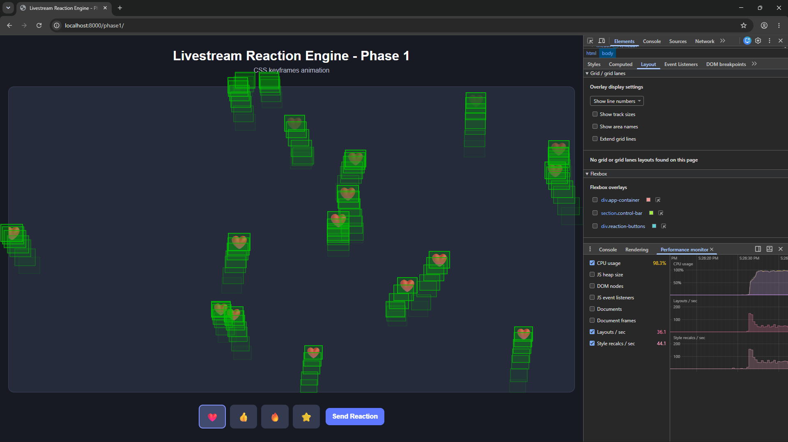
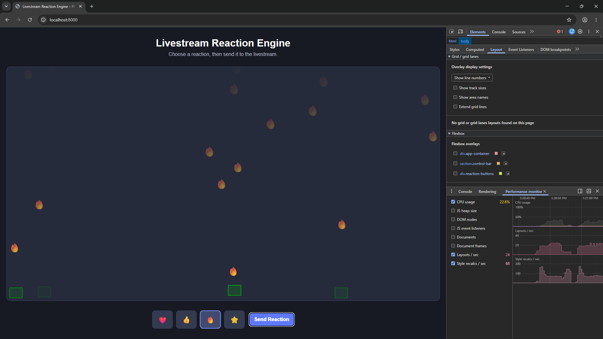

# Livestream Reaction Engine — Submission
## 1. Setup & Running Instructions
Run this command in the project folder:

```powershell
python -m http.server 8000 --directory docs
```

Open:
* `http://localhost:8000/`
* `http://localhost:8000/phase1/`
* `http://localhost:8000/phase2/`

## 2. Phase 1: CSS Keyframes Analysis
* **Paint Flashing Screenshot:** [Embed or link screenshot]


* **Performance Profile Screenshot:** [Embed or link screenshot]


* **Observations:**
* What regions of the screen flashed green during high-concurrency spawning, and why?
Green flashing appeared around the moving emojis when the browser needs to repaint. When changing bottom, left and font-size caused Layout and Paint operations on every animation frame.

* What did the main thread activity (Layout, Recalculate Style, Paint) look like in the flame chart?
Phase 1 had more layout, recalculate style and paint activity when many reactions were created. The Layout activity increased because each reaction was changing geometry.

## 3. Phase 2: GSAP & Composited Rendering Analysis
* **Performance Profile Screenshot:** [Embed or link screenshot]


* **Observations:**
* How did the flame chart and frame rate change compared to Phase 1?
Phase 2 is more smoother because it reduced Layout and Paint work and used CPU less heavily.

* What happened to the green paint invalidation areas once animations moved to composited transforms (`x`, `y`)?
The large green flashing areas were reduced because each reaction was moved using composited x and y transforms. So the browser can move existing composited layers without recalculating Layout or repainting the complete stage.

## 4. Architectural Reflection
* **Runtime Control & Developer Experience:** How does adjusting playback
speed or randomizing flight paths mid-flight compare between static CSS rules
and programmatic timelines?
CSS animations use fixed rules such as keyframe percentages and animation duration. Changing them requires modifying styles or classes and changing a flight path mid-animation is difficult. 
While GSAP timelines are programmatic, so playback speed, direction, opacity, position and random flight paths can be changed while an animation is running. This makes GSAP easier to control.

* **Pipeline Considerations:** If our application needed to dynamically tint,
re-theme, or alter these reaction assets at runtime based on active user
preferences, what architectural considerations dictate choosing programmatic
vector manipulation over pre-rendered raster image sequences?
Raster image sequences require many separate image files for every frame, colour, theme and resolution. This uses more storage, memory and network bandwidth. It is also difficult to tint or re-theme. 
While Programmatic vector such as SVG can change fill colours, strokes, size, direction and animation properties at runtime with code. Vectors is more suitable for user-controlled themes and dynamic reaction because it remains sharp at every screen size.